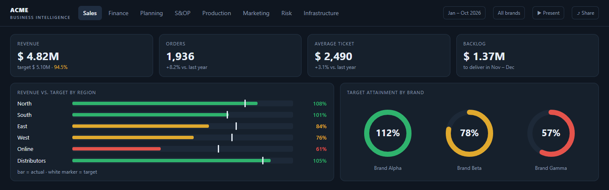
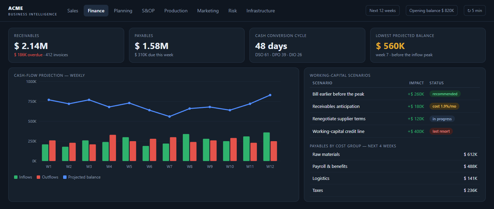
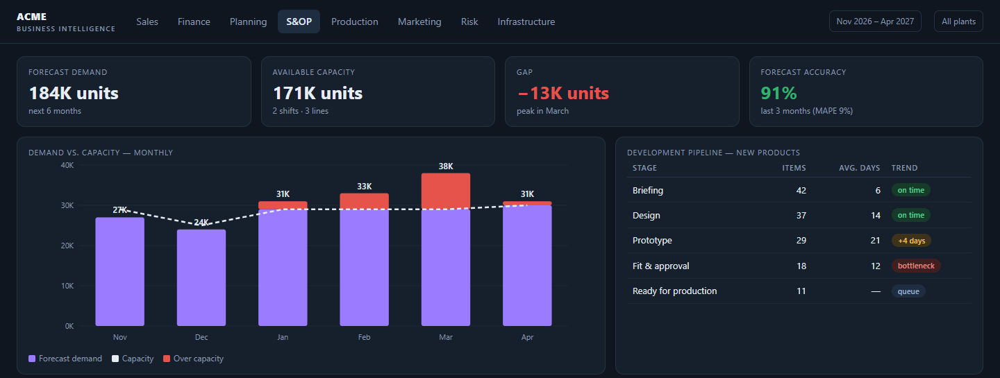
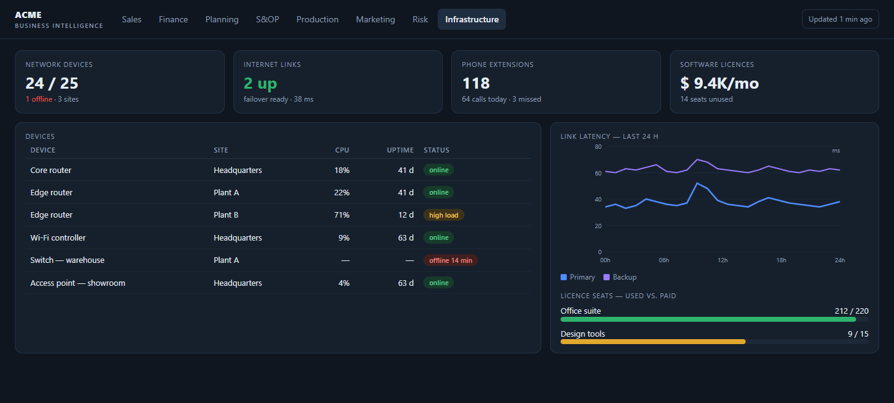
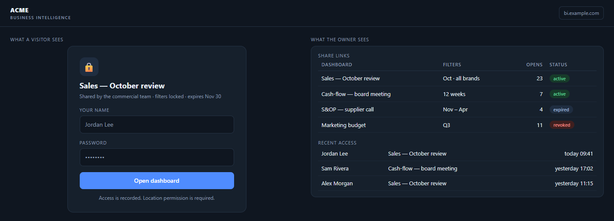
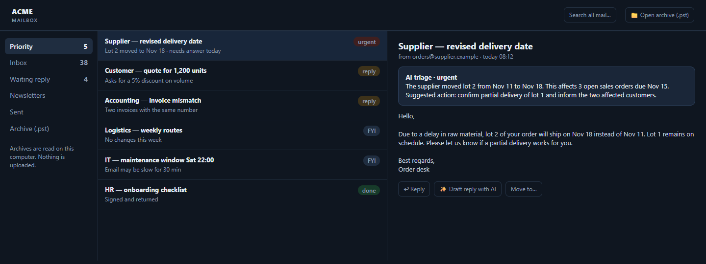
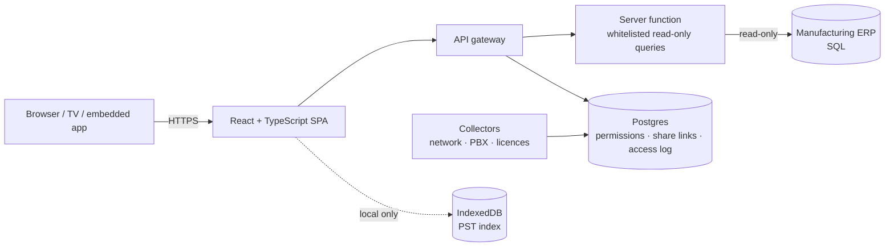

# Live ERP BI Portal — executive dashboards straight from the ERP

A business-intelligence portal I designed and built for the company I work at. It reads the
manufacturing ERP **live** (no nightly ETL, no data warehouse) and turns it into executive dashboards
for sales, finance, planning, production, marketing and IT — with per-dashboard permissions,
password-protected public links and a presentation mode for meeting-room TVs.

> This is a curated showcase. The production code lives in a private repository; everything here
> was written for this page. No credentials, IPs, company names, customers, people or business rules.



## What it covers

| Area | Dashboards |
| --- | --- |
| **Sales** | Revenue vs. target by rep, brand and region, customer portfolio, order backlog by delivery month |
| **Finance** | Receivables and payables snapshot, cash-flow projection, payment flow by cost group, working-capital scenarios |
| **Planning & S&OP** | Demand vs. capacity, product-development pipeline, licensing costs |
| **Production** | Throughput and lead time per stage |
| **Marketing** | Monthly budget vs. actual spend |
| **Risk** | Concentration and overdue exposure |
| **IT infrastructure** | Network devices and PBX status, fed by small collectors |
| **Mailbox** | A shared/personal inbox inside the portal with AI triage, plus an archive viewer that reads `.pst` files **locally in the browser** |

## Screens

All screens below are mocks with **fictitious data** — same layout and components as the real portal.

**Finance — cash-flow projection, working-capital scenarios and payables by cost group**


**S&OP — demand vs. capacity (over-capacity in red) and the new-product pipeline by stage**


**IT infrastructure — device status, link latency and licence seats, fed by small collectors**


**Share links — the visitor's password gate and the owner's view of links and access log**


**Mailbox — AI triage of the inbox and `.pst` archives read locally in the browser**


## Engineering highlights

- **Live, read-only ERP access.** Dashboards query the ERP through a thin server function with a whitelist of
  parameterised queries — the browser never talks to the ERP and nothing can write to it.
- **Fast first paint on a slow source.** The visible dashboard loads first and alone; the others load in the
  background **one at a time**, so long date ranges never saturate the ERP's connections. A failing dashboard
  keeps its last good data instead of breaking the page.
- **Targets that read at a glance.** Radial gauges and bullet charts (bar = actual, marker = target) with one
  colour rule everywhere: green ≥ 100 %, amber 70–99 %, red < 70 %.
- **Granular access.** Each dashboard can be granted per user; categories have their own capability flags.
  Every open is logged.
- **Public links without leaking the app.** A share link freezes the current filters, lives on a dedicated
  domain, asks the visitor for a name and password, records the access and can be revoked at any time.
- **Built for the meeting room.** Presentation mode rotates dashboards, fit-to-screen scales them to any TV,
  true fullscreen even when embedded in another app, compact density, light/dark theme and auto-refresh.
- **Privacy by design for e-mail archives.** `.pst` files are indexed in IndexedDB on the user's machine;
  search, bodies and attachments are read from the file on demand — nothing is uploaded.

## Architecture



## Code samples (written for this showcase)

**Visible first, the rest in the background — one at a time:**

```ts
type Loader = { key: string; load: () => Promise<unknown> };

export async function loadDashboards(
  visible: Loader,
  others: Loader[],
  store: (key: string, data: unknown) => void,
) {
  store(visible.key, await visible.load());          // the screen the user is looking at
  for (const l of others) {                          // sequential: gentle on the ERP
    try { store(l.key, await l.load()); }
    catch { /* keep the previous data for this dashboard */ }
  }
}
```

**One colour rule for every target:**

```ts
export type Band = 'good' | 'warning' | 'critical';

export function targetBand(actual: number, target: number): Band {
  if (target <= 0) return 'good';
  const pct = (actual / target) * 100;
  return pct >= 100 ? 'good' : pct >= 70 ? 'warning' : 'critical';
}
```

**Password-protected share link that logs every access** (Postgres):

```sql
create table share_links (
  token       text primary key,
  dashboard   text not null,
  filters     jsonb not null,            -- frozen when the link was created
  pass_hash   text not null,             -- crypt(password, gen_salt('bf'))
  revoked_at  timestamptz
);
create table share_access_log (link text, visitor text, at timestamptz default now());

create function open_share_link(p_token text, p_visitor text, p_pass text)
returns jsonb language plpgsql security definer as $$
declare l share_links;
begin
  select * into l from share_links where token = p_token and revoked_at is null;
  if l.token is null or crypt(p_pass, l.pass_hash) <> l.pass_hash then
    raise exception 'invalid_link_or_password';
  end if;
  insert into share_access_log (link, visitor) values (p_token, left(trim(p_visitor), 80));
  return jsonb_build_object('dashboard', l.dashboard, 'filters', l.filters);
end $$;
```

## Stack

React · TypeScript · Vite · Postgres (Supabase: Auth, RLS, server functions) · SQL against the ERP ·
SVG charts · IndexedDB · Python collectors

## Privacy note

Screenshots use fictitious data rendered from a mock. Company, people, customers, hosts and business rules
are intentionally omitted.
